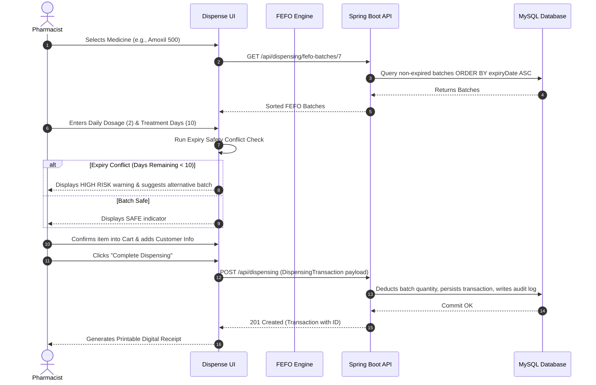

# MediTrack Pro — Comprehensive Feature Specification & System Documentation

> **Smart Pharma Audit, Intelligent Expiry Tracking, Demand Forecasting & Automated Reorder Management System**  
> *Production-Ready Full-Stack Healthcare Application for Modern Retail & Hospital Pharmacies*

---

## 📋 Table of Contents

1. [Executive Summary & Purpose](#1-executive-summary--purpose)
2. [High-Level Architecture & Tech Stack](#2-high-level-architecture--tech-stack)
3. [Role-Based Access Control (RBAC) Matrix](#3-role-based-access-control-rbac-matrix)
4. [Complete Feature Catalog](#4-complete-feature-catalog)
   - [4.1 Authentication & Session Security](#41-authentication--session-security)
   - [4.2 Admin Command Center & Dashboards](#42-admin-command-center--dashboards)
   - [4.3 Medicine Master Catalog](#43-medicine-master-catalog)
   - [4.4 Medicine Details & Consignment Inspector](#44-medicine-details--consignment-inspector)
   - [4.5 Batch & Consignment Lifecycle Management](#45-batch--consignment-lifecycle-management)
   - [4.6 Real-Time Inventory & Stock Adjustments](#46-real-time-inventory--stock-adjustments)
   - [4.7 Centralized Dispensing Audit Records](#47-centralized-dispensing-audit-records)
   - [4.8 Expiry Tracking & Perishability Radar](#48-expiry-tracking--perishability-radar)
   - [4.9 Pharmacist Staff Administration](#49-pharmacist-staff-administration)
   - [4.10 Regulatory Audit Logs](#410-regulatory-audit-logs)
   - [4.11 Multi-Dimensional Reports & Analytics](#411-multi-dimensional-reports--analytics)
   - [4.12 Smart Insights & AI Demand Forecasting](#412-smart-insights--ai-demand-forecasting)
   - [4.13 Automated Reorder Engine (Auto Reorder)](#413-automated-reorder-engine-auto-reorder)
   - [4.14 Inbound Supply Chain & Order Receiving](#414-inbound-supply-chain--order-receiving)
   - [4.15 System Preferences & Expiry Thresholds](#415-system-preferences--expiry-thresholds)
   - [4.16 Pharmacist Operations Center](#416-pharmacist-operations-center)
   - [4.17 Active Dispensing & Patient Safety Workflow](#417-active-dispensing--patient-safety-workflow)
   - [4.18 Pharmacist Expiry Alerts & History](#418-pharmacist-expiry-alerts--history)
5. [Core Algorithms & Mathematical Formulations](#5-core-algorithms--mathematical-formulations)
   - [5.1 Croston's Method with Syntetos-Boylan Approximation (SBA)](#51-crostons-method-with-syntetos-boylan-approximation-sba)
   - [5.2 First-Expired, First-Out (FEFO) Allocation Logic](#52-first-expired-first-out-fefo-allocation-logic)
   - [5.3 Patient Prescription Expiry Conflict Calculation](#53-patient-prescription-expiry-conflict-calculation)
   - [5.4 Suggested Reorder Quantity (ROQ) Formulation](#54-suggested-reorder-quantity-roq-formulation)
6. [End-to-End Workflow Lifecycles](#6-end-to-end-workflow-lifecycles)
   - [6.1 Patient Dispensing & Safety Verification Flow](#61-patient-dispensing--safety-verification-flow)
   - [6.2 Procurement, Inwarding & Auto-Stocking Flow](#62-procurement-inwarding--auto-stocking-flow)
7. [REST API Specification Matrix](#7-rest-api-specification-matrix)
8. [Database Schema & Data Model](#8-database-schema--data-model)
9. [Installation, Setup & Deployment Guide](#9-installation-setup--deployment-guide)
10. [Demo Credentials & Evaluation Walkthrough](#10-demo-credentials--evaluation-walkthrough)

---

## 1. Executive Summary & Purpose

### 1.1 Problem Statement
Pharmacies face multi-billion dollar losses annually due to expired medication, stockouts of critical drugs, and human error during dispensing. Traditional systems suffer from:
- **FIFO Disconnect:** Medicines are frequently stored and dispensed on a First-In, First-Out (FIFO) basis rather than **FEFO** (First-Expired, First-Out), resulting in older stock spoiling on back shelves.
- **Dispensing Blindspots:** Pharmacists lack automated safety checks to calculate whether a dispensed batch will expire *during* a patient's multi-week treatment cycle.
- **Intermittent Demand Forecasting Failure:** Standard linear algorithms fail when projecting pharmaceutical consumption due to sporadic demand patterns, leading to severe stockouts or costly overstock.
- **Disjointed Reordering:** Purchasing processes rely on manual clipboard tallies rather than automated demand-triggered purchase orders connected directly to stock inwarding.

### 1.2 MediTrack Pro Solution
**MediTrack Pro** is an enterprise-grade full-stack pharmacy management platform designed to eliminate perishable medicine waste, guarantee patient prescription safety, provide mathematical demand forecasting, and fully automate the reorder-to-inwarding inventory loop.

```
       ┌────────────────────────────────────────────────────────┐
       │                    MediTrack Pro                       │
       │    Smart Pharma Audit & Intelligent Stock Automation   │
       └──────────────────────────┬─────────────────────────────┘
                                  │
         ┌────────────────────────┴────────────────────────┐
         ▼                                                 ▼
┌─────────────────────────────────┐       ┌─────────────────────────────────┐
│          ADMIN PORTAL           │       │        PHARMACIST PORTAL        │
├─────────────────────────────────┤       ├─────────────────────────────────┤
│ • Executive Dashboard & KPI     │       │ • Daily Shift Dashboard         │
│ • Catalog & Batch Management    │       │ • FEFO Dispensing Engine        │
│ • Inventory Stock Reconciliation│       │ • Prescription Safety Check     │
│ • Dispensing Audit Oversight    │       │ • Digital Receipt Generation    │
│ • Croston-SBA Demand Forecast   │       │ • Real-Time Expiry Alerts       │
│ • Auto-Reorder & PO Processing  │       │ • Personal Dispensing History   │
│ • Order Receiving & Auto-Batches│       │ • Medicine Availability Search  │
│ • Audit Logs & Regulatory Export│       │                                 │
└─────────────────────────────────┘       └─────────────────────────────────┘
```

---

## 2. High-Level Architecture & Tech Stack

MediTrack Pro uses a decoupled **Single Page Application (SPA) + REST API + Relational Database** architecture.

```
┌─────────────────────────────────────────────────────────────────────────┐
│                        FRONTEND CLIENT (Vite + React)                   │
│  React 18  │  Tailwind CSS  │  React Router v6  │  Recharts  │  Lucide  │
└────────────────────────────────────┬────────────────────────────────────┘
                                     │ HTTP / REST (JSON)
                                     ▼
┌─────────────────────────────────────────────────────────────────────────┐
│                     BACKEND APPLICATION (Spring Boot 3.3)               │
│  Java 21  │  Spring Web MVC  │  Spring Data JPA  │  Jakarta Validation  │
└────────────────────────────────────┬────────────────────────────────────┘
                                     │ Hibernate ORM / JDBC
                                     ▼
┌─────────────────────────────────────────────────────────────────────────┐
│                      DATABASE TIER (MySQL 8.x)                          │
│   users  │  medicines  │  batches  │  dispensing_transactions  │        │
│   dispensing_items  │  reorder_orders  │  audit_logs                    │
└─────────────────────────────────────────────────────────────────────────┘
```

### Technical Stack Details
| Layer | Technologies | Key Highlights |
| :--- | :--- | :--- |
| **Frontend** | React 18, Vite, JavaScript (ES2022) | Instant HMR, component modularity, hooks-driven state |
| **Styling** | Tailwind CSS, Custom Design System | Responsive grid, custom brand tokens, clean typography |
| **Visualization** | Recharts (Area, Bar, Pie, Cell) | Smooth animated charts, custom tooltip overlays |
| **Routing & Auth** | React Router DOM v6, Context API | Protected role guards (`AdminRoute`, `PharmacistRoute`) |
| **Backend Core** | Java 21, Spring Boot 3.3.0 | Modern language features, records, dependency injection |
| **Data Layer** | Spring Data JPA, Hibernate, MySQL 8 | Transactional integrity (`@Transactional`), query methods |
| **Validation** | Jakarta Bean Validation, Spring Web | Strict DTO checking, custom global exception handling |
| **Algorithms** | Client-Side Croston-SBA & Java FEFO | Zero-latency forecast modeling with authentic DB history |

---

## 3. Role-Based Access Control (RBAC) Matrix

To ensure regulatory compliance and strict separation of administrative oversight from physical clinical operations, MediTrack Pro enforces role segregation:

| System Capability | Admin Role | Pharmacist Role | Architectural Rationale |
| :--- | :---: | :---: | :--- |
| **System Dashboard (KPIs, Trends)** | ✅ Full Access | ⚠️ Pharmacist-Scoped | Admin sees pharmacy-wide finances; Pharmacist sees daily operational goals |
| **Medicine Catalog (Add/Edit/Delete)** | ✅ Full Control | 👁️ Read-Only | Prevents unauthorized catalog changes at the dispensing counter |
| **Batch Provisioning & Adjustments** | ✅ Full Control | 👁️ Read-Only | Consignment inwarding and inventory reconciliation are administrative duties |
| **Active Dispensing (Cart, FEFO, Patient)** | ❌ Restricted | ✅ Full Access | **Enforces separation of duties:** Admins cannot dispense medications directly |
| **Dispensing History Ledger** | ✅ View All Staff | 👁️ View Own Records | Admin performs compliance audit; Pharmacist audits own shift output |
| **AI Demand Forecasting (Croston-SBA)** | ✅ Full Access | ❌ Restricted | Strategic purchasing and demand analysis belongs to management |
| **Auto-Reorder (Approve/Reject POs)** | ✅ Full Control | ❌ Restricted | Fiscal authorization for procurement rests with administrators |
| **Order Receiving & Auto-Batch Inwarding**| ✅ Full Control | ❌ Restricted | Verifying shipment delivery and updating inventory is an admin task |
| **Staff & User Management** | ✅ Full Control | ❌ Restricted | Only admins can provision or deactivate pharmacist accounts |
| **Regulatory Audit Log Inspector** | ✅ Full Control | ❌ Restricted | Tamper-evident oversight across all user transactions |
| **Report Generation & Export** | ✅ Full Access | ❌ Restricted | Comprehensive export of inventory, audits, and sales summaries |
| **System Settings & Expiry Thresholds** | ✅ Full Access | ❌ Restricted | Global parameter configuration is restricted to administrators |

---

## 4. Complete Feature Catalog

### 4.1 Authentication & Session Security
- **Dual Credential Authentication:** Validates email and password combinations against the database.
- **Role Redirection:** Instantly directs administrators to `/admin/dashboard` and pharmacists to `/pharmacist/dashboard`.
- **Protected Route Guards:** Intercepts direct URL manipulations; unauthenticated users are directed to `/login`, while unauthorized role attempts render an `Unauthorized (403)` screen.
- **Session State Hydration:** Retains active user role, display name, and unique user ID in application context and session storage.

---

### 4.2 Admin Command Center & Dashboards (`/admin/dashboard`)
- **Real-Time KPI Cards:**
  - *Total Medicines:* Total number of cataloged drug formulations.
  - *Total Stock:* Real-time summation of usable, non-expired batch quantities.
  - *Low Stock:* Count of medicines where usable stock $\le$ defined minimum buffer threshold.
  - *Near Expiry:* Batches expiring within the near-expiry window (31 to 90 days).
  - *Expired Batches:* Batches past their expiry date requiring immediate disposal.
  - *Today's Dispensing:* Total units dispensed by pharmacy staff in the current 24-hour cycle.
- **Interactive Visualizations:**
  - *Monthly Dispensing Trend (AreaChart):* 12-month rolling graph with gradient fill displaying volume fluctuations.
  - *Stock Distribution by Dosage Form (PieChart):* Category shares (Tablets, Capsules, Syrups, Injections).
  - *Perishability Health (BarChart):* Grouped count of Safe vs. Near Expiry vs. Critical vs. Expired consignments.
- **Live Audit Activity Feed:** Displays the 6 most recent actions across all pharmacy staff with timestamp and actor name.

---

### 4.3 Medicine Master Catalog (`/admin/medicines`)
- **Master CRUD Operations:** Create, review, modify, and manage pharmaceutical catalog entries.
- **Comprehensive Drug Profile:**
  - `Brand Name` (e.g., *Dolo 650*, *Amoxil 500*)
  - `Generic Active Ingredient` (e.g., *Paracetamol*, *Amoxicillin*)
  - `Manufacturer / Pharmaceutical Lab` (e.g., *Micro Labs*, *GSK*, *Cipla*)
  - `Strength / Potency` (e.g., *650 mg*, *500 mg*, *10 mg*)
  - `Dosage Form` (*Tablet, Capsule, Syrup, Injection, Ointment, Drops, Inhaler*)
  - `Minimum Buffer Stock Threshold` (Triggers low-stock warnings)
  - `Clinical Status` (*ACTIVE* or *INACTIVE*)
  - `Therapeutic Description & Indications`
- **Dynamic Live Stock Mapping:** Automatically queries active batches to display live usable units for every cataloged medicine without manual data entry.
- **Multi-Parameter Search & Filtering:** Instant client-side search across brand name, generic formulation, manufacturer, and dosage forms.

---

### 4.4 Medicine Details & Consignment Inspector (`/admin/medicines/:id`)
- **Medicine Overview Header:** Shows generic composition, brand identity, manufacturer, and therapeutic description.
- **Aggregated Health Metrics:**
  - *Total Stock* vs. *Usable Stock* (excluding expired consignments).
  - *Active Batches Count*.
  - *Earliest Expiry Date* among available consignments.
- **Consignment Batch Table:** Breakdown of every batch associated with the drug, including batch number, supplier, manufacturing date, expiry date, days remaining, current stock, and perishability badge.
- **Dispensing History Ledger:** History of every transaction involving this specific drug, including dates, quantities dispensed, and dispensing pharmacist.

---

### 4.5 Batch & Consignment Lifecycle Management (`/admin/batches`)
- **Hierarchical Drug Grouping:** When provisioning a new batch, administrators first select the generic active ingredient, which dynamically filters the selectable branded products.
- **Batch Metadata Tracking:**
  - Batch Number (unique alphanumeric batch ID)
  - Supplier / Distributor name
  - Manufacturing Date (`mfgDate`)
  - Expiry Date (`expiryDate`)
  - Received Consignment Date (`receivedDate`)
  - Total Units Received / Current Stock
- **Color-Coded Perishability Status:**
  - 🟢 **Safe:** $>90$ days remaining.
  - 🟡 **Near Expiry:** $31 - 90$ days remaining.
  - 🟠 **Critical:** $1 - 30$ days remaining.
  - 🔴 **Expired:** $\le 0$ days remaining.
- **Batch Editing & Audited Count Corrections:** Update supplier details, expiry corrections, or adjust physical quantities with automatic audit trail recording.

---

### 4.6 Real-Time Inventory & Stock Adjustments (`/admin/inventory`)
- **Centralized Stock Registry:** Complete ledger of all stocked batches, showing current units, minimum buffer limits, and stock statuses (`HEALTHY`, `LOW STOCK`, `OUT OF STOCK`).
- **Physical Reconciliation Modal:**
  - Supports manual **Add** (+) or **Deduct** (-) stock adjustments.
  - Requires mandatory adjustment reason (e.g., *Damaged in transit, Ward return, Physical audit count mismatch, Spillage*).
  - Updates batch quantity and triggers an automatic entry in the immutable audit log.

---

### 4.7 Centralized Dispensing Audit Records (`/admin/dispensing`)
- **Read-Only Oversight Ledger:** Complete record of all dispensing transactions across all pharmacists.
- **Transaction Details:**
  - Transaction ID and Reference / Prescription Number.
  - Customer / Patient Name and Contact Phone.
  - Dispensing Pharmacist name.
  - Date and exact timestamp.
  - Item count and total units dispensed.
- **Transaction Details Modal:** Opens any transaction to inspect individual line items, including medicine names, allocated batch numbers, expiry dates at time of dispense, and quantities.
- **Filtering:** Search by customer name, phone number, pharmacist, date, or dispensed drug.

---

### 4.8 Expiry Tracking & Perishability Radar (`/admin/expiry`)
- **Perishability Status Radar:** Chronological list of all pharmacy consignments sorted by days remaining until expiration.
- **High-Risk Highlighting:** Batches in *Critical* or *Expired* states are highlighted to prevent accidental dispensing and facilitate immediate quarantine.
- **Perishability Distribution Chart:** Bar chart illustrating batch volume grouped into Safe, Near Expiry, Critical, and Expired categories.

---

### 4.9 Pharmacist Staff Administration (`/admin/pharmacists`)
- **Staff Provisioning:** Onboard new licensed pharmacists with Name, Email, Phone number, and Password.
- **Account State Management:** Activate or deactivate pharmacist accounts. Deactivated staff are immediately prevented from logging in.
- **Credential Updates:** Update contact details or reset passwords for pharmacy personnel.

---

### 4.10 Regulatory Audit Logs (`/admin/audit-logs`)
- **Immutable System Log:** Records all state-changing activities across the application.
- **Audit Data Captured:**
  - Timestamp (ISO-8601 with millisecond precision)
  - User Name and User Role (`ADMIN`, `PHARMACIST`)
  - Action Key (`USER_LOGIN`, `MEDICINE_CREATED`, `BATCH_CREATED`, `DISPENSING_COMPLETED`, `STOCK_ADJUSTED`, `REORDER_APPROVED`, `ORDER_RECEIVED`, etc.)
  - Entity Type and Entity ID (`Medicine:4`, `DispensingTransaction:12`)
  - Human-readable narrative detailing the change.
- **Multi-Filter Engine:** Filter logs by User, Role, Action Type, Entity, and Date range.

---

### 4.11 Multi-Dimensional Reports & Analytics (`/admin/reports`)
- **On-Demand Report Generators:**
  1. **Inventory Valuation & Health Report:** Comprehensive snapshot of catalog stock levels, categories, and health flags.
  2. **Expiry Risk Analysis Report:** All active batches with remaining shelf life and risk ratings.
  3. **Dispensing Transaction Report:** Complete sales and dispensing activity with pharmacist attribution.
  4. **System Audit Trail Report:** Exportable log of operational and administrative modifications.
  5. **Low Stock Exception Report:** Critical report detailing items that have breached minimum safety thresholds.
- **Interactive Data Table:** Filterable, searchable, and printable directly from the browser.

---

### 4.12 Smart Insights & AI Demand Forecasting (`/admin/insights`)
- **Dual-Level Selection:** Analyze forecasting at the *Generic Class* level or drill down to individual *Brand Name Formulations*.
- **Croston’s Method with Syntetos-Boylan Approximation (SBA):** Specialized mathematical model that accurately projects intermittent pharmaceutical demand where standard moving averages fail.
- **Forecast Horizon Metrics:**
  - *7-Day Projected Demand:* Immediate operational replenishment requirement.
  - *30-Day Projected Demand:* Monthly procurement planning target.
  - *Model Accuracy Rate (%):* Calculated using in-sample Weighted Absolute Percentage Error (WAPE).
  - *Projected Stock Runout Date:* Estimated date when current inventory will hit zero based on daily burn rate.
- **Visual Demand Trajectory (Recharts AreaChart):** Overlays authentic historical dispensing actuals, Croston-SBA fitted curve, and projected future demand.

---

### 4.13 Automated Reorder Engine (Auto Reorder) (`/admin/reorder`)
- **Automated Stock Level Evaluation:** Monitors all medicine inventory against minimum safety stock thresholds and 30-day Croston-SBA projected demand.
- **Reorder Status Badges:**
  - 🟢 **HEALTHY:** Inventory is sufficient; no action needed.
  - 🔴 **LOW STOCK / REORDER REQUIRED:** Stock is below buffer threshold; purchase order recommended.
  - 🟡 **ORDERED:** Purchase order has been approved and placed; awaiting warehouse delivery.
- **Suggested Reorder Quantity (ROQ) Calculation:** Dynamically computes optimal replenishment quantities based on demand forecasts and safety buffers.
- **One-Click Purchase Order Generation:**
  - Highlights low-stock items automatically.
  - Administrator can accept the suggested quantity or adjust the approved quantity in an editable field.
  - Clicking **"Approve & Place Order"** creates a persistent `ReorderOrder` record with `ORDERED` status and updates the UI badge to 🟡 ORDERED.

---

### 4.14 Inbound Supply Chain & Order Receiving (`/admin/order-received`)
- **Procurement Tracking:** Tracks the lifecycle of approved purchase orders from supplier placement to warehouse inwarding.
- **Tabbed Views:**
  - *Awaiting Delivery (`ORDERED`):* Active orders pending delivery.
  - *Received Shipments (`RECEIVED`):* Historical consignments delivered and inwarded into stock.
  - *All Orders:* Complete purchase order log.
- **Inward Stock Receiving Modal:**
  - Triggered by clicking **"Receive & Add Stock"** on an awaiting order.
  - Administrator confirms: Actual Received Quantity, New Consignment Batch Number, Manufacturing Date, Expiry Date, and Supplier Name.
- **Automated Inventory Inwarding:**
  - Updates the purchase order status to `RECEIVED`.
  - Automatically creates a new `Batch` record in the database linked to the medicine.
  - Immediately increments the medicine's usable inventory.
  - Resets the medicine's reorder badge in the Auto Reorder module back to 🟢 HEALTHY.
  - Generates an immutable audit log entry documenting stock receipt.

---

### 4.15 System Preferences & Expiry Thresholds (`/admin/settings`)
- **Administrator Profile Management:** Update name, email, and contact phone number.
- **Security & Password Management:** Change administrative login password.
- **Configurable Expiry Horizons:**
  - Adjust the *Near Expiry Threshold* (default: 90 days).
  - Adjust the *Critical Expiry Threshold* (default: 30 days).
  - Adjust the *Default Minimum Safety Stock* for new catalog medicines.
- **Notification Preference Toggles:** Toggle real-time alerts for low stock, near expiry, expired batches, and new dispensing transactions.

---

### 4.16 Pharmacist Operations Center (`/pharmacist/dashboard`)
- **Operational Shift Dashboard:**
  - *Shift Dispensing Metrics:* Total units and transactions completed during the active shift.
  - *Available Medicines Count:* Quick count of active medications ready for dispensing.
  - *Urgent Expiry Radar:* Displays batches nearing expiry to encourage stock rotation.
- **Quick-Action Dispense CTA:** One-click launchpad directing pharmacists into the active dispensing workflow.
- **Recent Transactions Ledger:** Quick reference table of the pharmacist's most recent patient transactions.

---

### 4.17 Active Dispensing & Patient Safety Workflow (`/pharmacist/dispense`)
The core clinical module of MediTrack Pro incorporates a **6-step safety-guided dispensing workflow**:

```
┌──────────────┐    ┌──────────────┐    ┌──────────────┐
│ 1. SEARCH    │ ──▶│ 2. SELECT    │ ──▶│ 3. FEFO BATCH│
│    Medicine  │    │    Medicine  │    │    Selection │
└──────────────┘    └──────────────┘    └──────┬───────┘
                                               │
┌──────────────┐    ┌──────────────┐    ┌──────▼───────┐
│ 6. RECEIPT   │ ◀──│ 5. REVIEW    │ ◀──│ 4. QUANTITY  │
│    & Print   │    │    & Cart    │    │    & Safety  │
└──────────────┘    └──────────────┘    └──────────────┘
```

- **Step 1 & 2 — Medicine Search & Selection:** Fast search across brand name, generic active ingredient, strength, or dosage form.
- **Step 3 — Intelligent FEFO Batch Prioritization:**
  - System automatically retrieves all non-expired batches for the selected drug, sorted strictly in ascending order of expiry date (**First-Expired, First-Out**).
  - The earliest expiring batch is highlighted as the primary candidate to minimize stock obsolescence.
- **Step 4 — Prescription Safety & Expiry Risk Assessment:**
  - Pharmacist enters: Desired Quantity, Daily Dosage (units/day), and Prescribed Treatment Duration (Days).
  - **Dynamic Patient Safety Calculation:** Calculates whether the batch will expire before the patient finishes their treatment ($DaysRemaining < TreatmentDays$).
  - If a conflict is detected, the system displays a **CRITICAL / HIGH RISK** warning and recommends longer-shelf-life alternative batches.
- **Step 5 — Cart Review & Patient Details:**
  - Add multiple prescription items into a unified cart.
  - Enter Patient Name, Contact Phone, Patient ID, and Doctor's Prescription / Reference Number.
- **Step 6 — Atomic Checkout & Digital Receipt:**
  - Submits transaction to the backend; Spring Boot verifies stock in an atomic `@Transactional` boundary and decrements the selected batch.
  - Generates a printable digital receipt with Transaction ID, Pharmacist Name, Patient Details, Itemized Batches, and Expiry Dates.

---

### 4.18 Pharmacist Expiry Alerts & History (`/pharmacist/expiry-alerts` & `/pharmacist/history`)
- **Pharmacist Expiry Alerts:** Real-time list of all near-expiry and critical batches to keep counter staff informed during dispensing.
- **Personal Dispensing History:** Comprehensive historical ledger of all transactions completed by the logged-in pharmacist, complete with line-item inspection modals.

---

## 5. Core Algorithms & Mathematical Formulations

### 5.1 Croston's Method with Syntetos-Boylan Approximation (SBA)
Standard moving averages and exponential smoothing fail for pharmaceuticals because demand is intermittent — characterized by periods of zero demand punctuated by occasional orders of varying sizes.

MediTrack Pro implements **Croston’s Method with Syntetos-Boylan Approximation (SBA)**:

#### Algorithmic Formulation:
Given demand series $Y = [y_1, y_2, \dots, y_T]$:
1. When non-zero demand occurs at period $t$ ($y_t > 0$):
   $$\text{Demand Level Update: } z_t = z_{t-1} + \alpha (y_t - z_{t-1})$$
   $$\text{Inter-Arrival Interval Update: } p_t = p_{t-1} + \alpha (q - p_{t-1})$$
   $$\text{Reset elapsed counter: } q = 1$$
2. When zero demand occurs ($y_t = 0$):
   $$z_t = z_{t-1}, \quad p_t = p_{t-1}, \quad q = q + 1$$
3. Standard Croston forecast produces positive bias; the **Syntetos-Boylan Approximation (SBA)** applies a deflation factor:
   $$\hat{y}_{t+1} = \left(1 - \frac{\alpha}{2}\right) \times \frac{z_t}{p_t}$$
   *(where $\alpha = 0.2$ is the smoothing constant).*

#### Forecast Projections & In-Sample Accuracy:
- **30-Day Projected Demand:**
  $$\text{Forecast}_{30d} = \max\left(1, \text{round}\left(\hat{y}_{t+1}\right)\right)$$
- **7-Day Projected Demand:**
  $$\text{Forecast}_{7d} = \max\left(1, \text{round}\left(\frac{\text{Forecast}_{30d} \times 7}{30}\right)\right)$$
- **Weighted Absolute Percentage Error (WAPE):**
  $$\text{WAPE} = \frac{\sum_{t=1}^T |y_t - \hat{y}_t|}{\sum_{t=1}^T y_t}$$
- **Model Accuracy Rate (%):**
  $$\text{Accuracy} = \max\left(62\%, \min\left(95\%, \text{round}((1 - \text{WAPE}) \times 100)\right)\right)$$

---

### 5.2 First-Expired, First-Out (FEFO) Allocation Logic
To prevent medication expiry on shelves, batch allocation follows strict FEFO ordering:

```sql
SELECT b FROM Batch b 
WHERE b.medicine.id = :medicineId 
  AND b.quantity > 0 
  AND b.expiryDate > CURRENT_DATE 
ORDER BY b.expiryDate ASC, b.id ASC
```

```
Batch A: Expiry = 2026-11-15 (Days Left: 33)  ──▶ [Primary Allocation: Dispensed First]
Batch B: Expiry = 2027-04-20 (Days Left: 189) ──▶ [Secondary Allocation: Held in Reserve]
Batch C: Expiry = 2027-09-10 (Days Left: 332) ──▶ [Tertiary Allocation: Held in Reserve]
```

---

### 5.3 Patient Prescription Expiry Conflict Calculation
Before dispensing a batch, the system calculates whether the medicine will expire during the patient's treatment regimen:

$$\text{Required Quantity} = \lceil \text{Daily Dosage} \times \text{Treatment Days} \rceil$$
$$\text{Days Remaining} = \lfloor (\text{Expiry Date} - \text{Current Date}) \text{ in days} \rfloor$$
$$\text{Conflict Detected} \iff \text{Days Remaining} < \text{Treatment Days}$$

#### Perishability Risk Classification:
| Condition | Risk Level | System Action |
| :--- | :---: | :--- |
| $\text{Days Remaining} \le 7 \land \text{Conflict} = \text{true}$ | **CRITICAL** | Blocks dispensing; recommends longer-dated batch |
| $\text{Days Remaining} < \text{Treatment Days}$ | **HIGH** | Displays warning banner; highlights alternative batches |
| $\text{Days Remaining} \le 90 \land \text{No Conflict}$ | **MEDIUM** | Warns pharmacist to advise patient on shelf life |
| $\text{Days Remaining} > 90 \land \text{No Conflict}$ | **LOW** | Safe for immediate dispensing |

---

### 5.4 Suggested Reorder Quantity (ROQ) Formulation
When stock drops below minimum safety thresholds, the Auto Reorder engine calculates the optimal purchase quantity:

$$\text{Current Usable Stock} = \sum_{b \in \text{Valid Batches}} b.\text{quantity}$$
$$\text{Suggested ROQ} = \max\Big(\text{Forecast}_{30d} + \text{Minimum Stock} - \text{Current Stock}, \; \text{Minimum Stock} \times 2\Big)$$

This ensures the pharmacy orders enough stock to cover both forecasted 30-day demand and the minimum safety buffer, with a fallback to double the minimum stock.

---

## 6. End-to-End Workflow Lifecycles

### 6.1 Patient Dispensing & Safety Verification Flow



---

### 6.2 Procurement, Inwarding & Auto-Stocking Flow

```mermaid
sequenceDiagram
    autonumber
    actor A as Administrator
    participant RO as Auto-Reorder UI
    participant REC as Order Received UI
    participant BE as Spring Boot API
    participant DB as MySQL Database

    RO->>RO: Evaluates Usable Stock vs Min Stock & Croston Forecast
    RO-->>A: Highlights LOW STOCK items with Suggested ROQ
    A->>RO: Reviews/edits quantity, clicks "Approve & Place Order"
    RO->>BE: PUT /api/reorders/{id}/approve (approvedQuantity)
    BE->>DB: Updates ReorderOrder status to 'ORDERED'
    DB-->>BE: Saved
    BE-->>RO: Status updated to ORDERED (Yellow Badge)
    Note over A,REC: Supplier ships consignment to pharmacy
    A->>REC: Opens "Order Received" -> "Awaiting Delivery" tab
    A->>REC: Clicks "Receive & Add Stock"
    REC-->>A: Displays Modal (Batch #, Mfg Date, Expiry Date, Received Qty)
    A->>REC: Submits delivery confirmation
    REC->>BE: PUT /api/reorders/{id}/receive + POST /api/batches
    BE->>DB: Creates new Batch & updates ReorderOrder to 'RECEIVED'
    DB-->>BE: Commit OK
    BE-->>REC: 200 OK (Stock updated)
    REC-->>A: Shows success toast; Auto Reorder status resets to HEALTHY (Green)
```

---

## 7. REST API Specification Matrix

| Method | Endpoint | Description | Request Body | Response Codes |
| :--- | :--- | :--- | :--- | :--- |
| `POST` | `/api/auth/login` | Authenticate user credentials | `{ email, password }` | `200 OK`, `401 Unauthorized` |
| `GET` | `/api/medicines` | Retrieve all catalog medicines | *None* | `200 OK` |
| `GET` | `/api/medicines/{id}` | Get medicine details by ID | *None* | `200 OK`, `404 Not Found` |
| `POST` | `/api/medicines` | Create a new catalog medicine | `Medicine` JSON | `201 Created`, `400 Bad Request` |
| `PUT` | `/api/medicines/{id}` | Update existing catalog medicine | `Medicine` JSON | `200 OK`, `404 Not Found` |
| `DELETE`| `/api/medicines/{id}` | Delete catalog medicine | *None* | `204 No Content` |
| `GET` | `/api/batches` | Retrieve all medicine batches | *None* | `200 OK` |
| `GET` | `/api/batches/medicine/{id}` | Batches for specific medicine | *None* | `200 OK` |
| `POST` | `/api/batches` | Inward/provision a new batch | `Batch` JSON | `201 Created`, `400 Bad Request` |
| `PUT` | `/api/batches/{id}` | Update batch or adjust stock | `Batch` JSON | `200 OK`, `404 Not Found` |
| `DELETE`| `/api/batches/{id}` | Delete/quarantine a batch | *None* | `204 No Content` |
| `GET` | `/api/dispensing` | Retrieve all dispensing records | *None* | `200 OK` |
| `GET` | `/api/dispensing/{id}` | Get dispensing transaction by ID | *None* | `200 OK`, `404 Not Found` |
| `POST` | `/api/dispensing` | Process new dispensing transaction | `DispensingTransaction` JSON | `201 Created`, `400 Bad Request` |
| `POST` | `/api/dispensing/ensure-history` | Seed/verify 6-month historical data | *None* | `200 OK` |
| `GET` | `/api/reorders` | List reorder purchase orders | Optional query: `?status=ORDERED` | `200 OK` |
| `POST` | `/api/reorders` | Create reorder purchase order | `ReorderOrder` JSON | `201 Created` |
| `PUT` | `/api/reorders/{id}/approve` | Approve reorder and place order | `{ approvedQuantity }` | `200 OK` |
| `PUT` | `/api/reorders/{id}/reject` | Reject suggested reorder | `{ reason }` | `200 OK` |
| `PUT` | `/api/reorders/{id}/receive` | Confirm receipt of reorder | *None* | `200 OK` |
| `GET` | `/api/audit-logs` | Retrieve all system audit logs | *None* | `200 OK` |
| `GET` | `/api/users/pharmacists` | List all pharmacist user accounts | *None* | `200 OK` |
| `POST` | `/api/users` | Create new pharmacist user | `User` JSON | `201 Created` |
| `PUT` | `/api/users/{id}` | Update pharmacist user details | `User` JSON | `200 OK` |

---

## 8. Database Schema & Data Model

MediTrack Pro runs on a normalized MySQL relational schema:

```text
               ┌───────────────────────┐
               │         users         │
               ├───────────────────────┤
               │ id (PK)               │
               │ name, email, password │
               │ phone, role, status   │
               └──────────┬────────────┘
                          │ 1
                          │
                          │ *
               ┌──────────┴────────────┐
               │ dispensing_transactions
               ├───────────────────────┤
               │ id (PK)               │
               │ pharmacist_id (FK)    │
               │ customer_name, phone  │
               │ patient_id, ref_no    │
               │ transaction_date      │
               │ total_items, total_qty│
               └──────────┬────────────┘
                          │ 1
                          │
                          │ *
┌────────────────┐     ┌──┴────────────────────┐     ┌────────────────┐
│   medicines    │     │   dispensing_items    │     │    batches     │
├────────────────┤     ├───────────────────────┤     ├────────────────┤
│ id (PK)        │◀─┐  │ id (PK)               │  ┌─▶│ id (PK)        │
│ brand_name     │  │  │ transaction_id (FK)   │  │  │ medicine_id(FK)│
│ generic_med    │  └──┼─medicine_id (FK)      │  │  │ batch_number   │
│ manufacturer   │     │ batch_id (FK)─────────┼──┘  │ mfg_date       │
│ strength       │     │ quantity              │     │ expiry_date    │
│ dosage_form    │     │ expiry_at_dispense    │     │ supplier       │
│ minimum_stock  │     └───────────────────────┘     │ received_date  │
│ status, desc   │                                   │ quantity       │
└───────┬────────┘                                   └────────────────┘
        │ 1
        │
        │ *
┌───────┴───────────────┐
│    reorder_orders     │
├───────────────────────┤
│ id (PK)               │
│ medicine_id (FK)      │
│ suggested_quantity    │
│ approved_quantity     │
│ status (PENDING/      │
│   ORDERED/RECEIVED)   │
│ created_at, approved_at│
└───────────────────────┘
```

---

## 9. Installation, Setup & Deployment Guide

### 9.1 Prerequisites
- **Java Development Kit (JDK):** Version 21 or higher
- **Node.js:** Version 18.x or 20.x LTS
- **Build Tools:** Apache Maven 3.8+ and npm
- **Database:** MySQL Server 8.0+

---

### 9.2 Database Setup
1. Open MySQL command line or MySQL Workbench:
   ```sql
   CREATE DATABASE meditrack CHARACTER SET utf8mb4 COLLATE utf8mb4_unicode_ci;
   ```
2. Verify connection settings in `backend/src/main/resources/application.properties`:
   ```properties
   spring.datasource.url=jdbc:mysql://localhost:3306/meditrack?createDatabaseIfNotExist=true&useSSL=false&allowPublicKeyRetrieval=true&serverTimezone=UTC
   spring.datasource.username=root
   spring.datasource.password=root
   spring.jpa.hibernate.ddl-auto=update
   server.port=8081
   ```

---

### 9.3 Backend Startup
```bash
# Navigate to backend directory
cd backend

# Clean build and compile
mvn clean install -DskipTests

# Run Spring Boot application
mvn spring-boot:run
```
*Backend initializes on port **8081**. On first startup, `DataSeeder` automatically populates the database with demo users, medicines, batches, and historical dispensing records.*

---

### 9.4 Frontend Startup
```bash
# Navigate to frontend directory
cd frontend

# Install npm dependencies
npm install

# Launch Vite development server
npm run dev
```
*Frontend runs at `http://localhost:5173` (or Vite's assigned local port).*

---

## 10. Demo Credentials & Evaluation Walkthrough

### 10.1 Demo Login Credentials

| User Persona | Email | Password | Assigned Role | Primary Workflow |
| :--- | :--- | :--- | :--- | :--- |
| **Pharmacy Administrator** | `admin@meditrack.com` | `admin123` | `ADMIN` | Inventory, POs, AI Forecasts, Audits |
| **Licensed Pharmacist** | `pharmacist@meditrack.com` | `pharma123` | `PHARMACIST` | Clinical FEFO Dispensing, Safety Checks |

---

### 10.2 Recommended Evaluation Walkthrough

#### Scenario A: Admin Procurement & Inwarding Loop
1. Log in as **Admin** (`admin@meditrack.com` / `admin123`).
2. Navigate to **Auto Reorder** (`/admin/reorder`):
   - Notice medicines marked 🔴 **LOW STOCK** with Croston-SBA Suggested Reorder Quantities.
   - Click **"Approve & Place Order"** on an item. Observe the badge transition to 🟡 **ORDERED**.
3. Navigate to **Order Received** (`/admin/order-received`):
   - In the **Awaiting Delivery** tab, find the newly placed order.
   - Click **"Receive & Add Stock"**. Enter batch number `BATCH-DEMO-2026`, manufacturing date, expiry date (e.g., 2028-10-01), and received quantity.
   - Confirm receipt: The order moves to the **Received Shipments** tab.
4. Return to **Auto Reorder**: Observe the medicine's status has automatically updated to 🟢 **HEALTHY**.

#### Scenario B: Pharmacist Safety-First Dispensing Loop
1. Log in as **Pharmacist** (`pharmacist@meditrack.com` / `pharma123`).
2. Navigate to **Dispense Medicine** (`/pharmacist/dispense`):
   - Search for a medication (e.g., *Amoxil 500* or *Dolo 650*).
   - Click **Select Medicine**: Observe batches sorted automatically by **FEFO** (earliest expiry first).
   - Enter Daily Dosage (e.g., `3`) and Treatment Days (e.g., `14`).
   - If an expiring batch is selected, notice the **Patient Expiry Conflict** alert with alternative batch suggestions.
   - Proceed to **Cart Review**, enter customer name and phone number, and click **"Complete Dispensing"**.
   - Review and print the generated **Digital Receipt**.
3. Navigate to **Dispensing History** (`/pharmacist/history`) to confirm the transaction is permanently recorded.

---

*MediTrack Pro — Built for modern pharmacy operations, regulatory compliance, and patient safety.*
